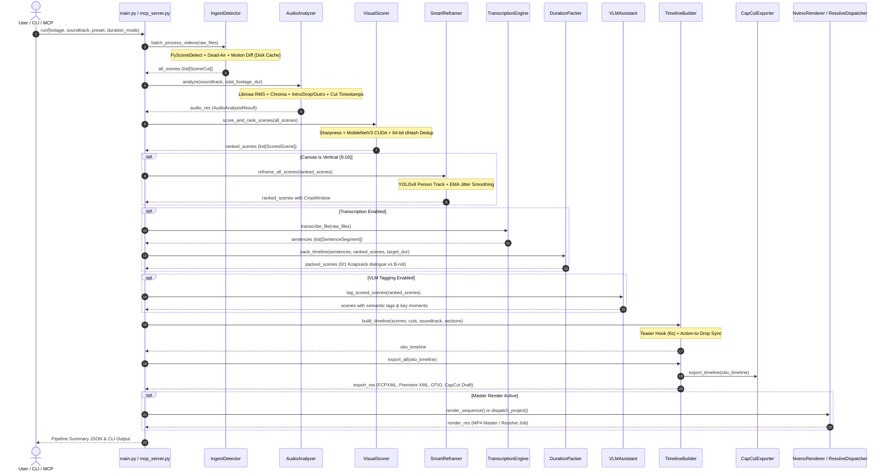
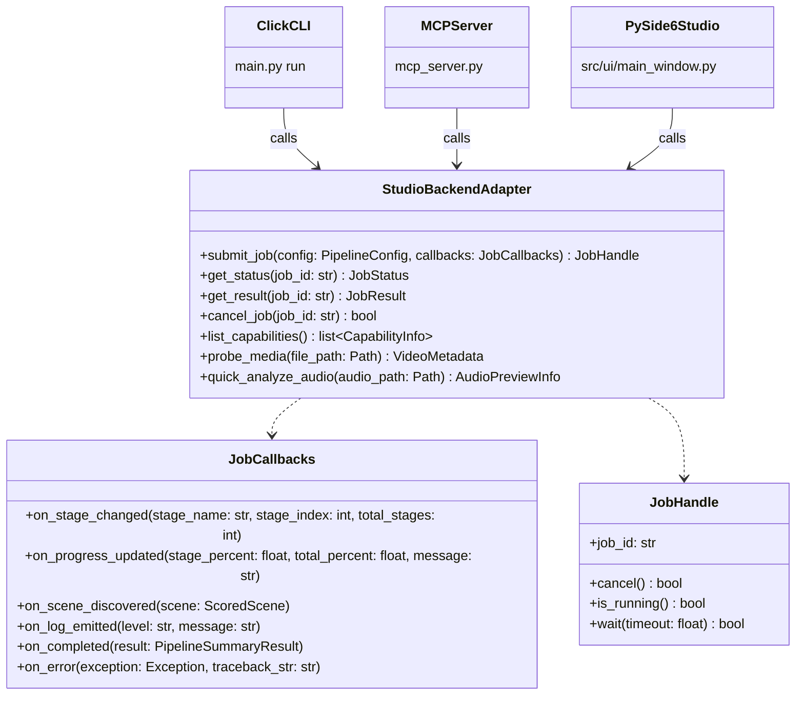
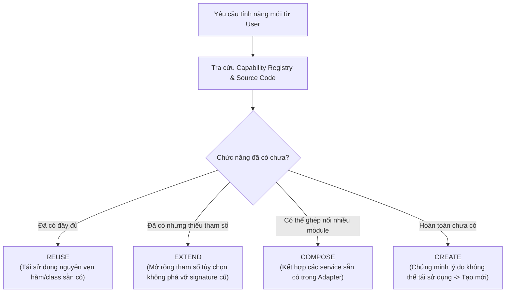

# PRE-PHASE-6 ARCHITECTURE & INTEGRATION AUDIT
**Project:** TeamTrau-AutoEdit (Production-Grade Automated Video Editing Orchestrator)  
**Target Next Phase:** Phase 6 — Cross-Platform Asynchronous Desktop Studio (PySide6 / Qt GUI)  
**Audit Date:** 2026-10-16  
**Environment Baseline:** Windows 11 Enterprise (Build 26100), Python 3.11.15, NVIDIA GeForce RTX 3070 (CUDA 12.4 / PyTorch 2.6.0+cu124), FFmpeg 8.1.2 (NVENC active), DaVinci Resolve Studio 21 API.  
**Test Suite Status:** 70/70 Passed (`pytest tests -v`), 0 Errors (`ruff check src tests main.py`).

---

## 1. Executive Summary & Audit Objectives

Bản audit này được thực hiện trước khi khởi tạo **Phase 6 (Desktop Studio PySide6 / Qt GUI)** nhằm thiết lập **Single Source of Truth** về năng lực kỹ thuật hiện có của hệ thống.

### Nguyên Tắc Bất Biến (Guiding Invariants):
1. **Zero Duplicate Implementations:** GUI mới không bao giờ tự xây dựng pipeline riêng, không gọi trực tiếp private functions, không tái phát minh thuật toán. Mọi thao tác biên tập đều tái sử dụng các service interface hiện hữu.
2. **Strict Verification (No Hallucination):** Không suy đoán chức năng hoạt động chỉ vì có file hoặc class. Trạng thái chỉ được công nhận qua bằng chứng thực tế từ source code, call sites, và kiểm thử.
3. **Non-Blocking UI & Hardware Protection:** Tác vụ nặng (YOLO, Whisper, Librosa, FFmpeg NVENC) chạy hoàn toàn trên worker threads (`QThreadPool`), hỗ trợ cập nhật tiến trình (Progress Callback), hủy tác vụ an toàn (Cancellation), và ngăn ngừa cạn kiệt bộ nhớ đồ họa (GPU VRAM Contention).

---

## 2. Capability Matrix & Integration Status

Phân loại trạng thái tích hợp:
- **`VERIFIED`**: Source code hoàn chỉnh, typing chuẩn Python 3.11+, đã được wire vào `main.py` CLI hoặc pipeline, và có unit/integration test pass 100%.
- **`PARTIALLY VERIFIED`**: Source code đã chạy và test pass, nhưng phụ thuộc điều kiện môi trường bên ngoài (ví dụ DaVinci Resolve Studio mở sẵn, hoặc có bước fallback).
- **`UNVERIFIED`**: Code tồn tại trong repository nhưng chưa có test thực tế hoặc chưa có phần cứng phù hợp để kiểm chứng tại chỗ.
- **`NOT CONNECTED`**: Function/class hoàn chỉnh nhưng chưa được expose ra CLI `main.py` hoặc MCP server, chỉ có thể gọi nội bộ.

| ID | Tên Capability | Module & Symbol | Input / Output | Phụ thuộc chính | Caller Hiện Tại | UI Entry Point Dự Kiến | Execution Mode | Progress / Cancel | Trạng Thái |
| :--- | :--- | :--- | :--- | :--- | :--- | :--- | :--- | :--- | :--- |
| **CAP-01** | Video Stream Probing | [`IngestDetector.probe_video`](file:///e:/antigravity/TeamTrau-AutoEdit/src/modules/ingest_detector.py#L28-L56) | `Path` → [`VideoMetadata`](file:///e:/antigravity/TeamTrau-AutoEdit/src/core/types.py#L8) | OpenCV `cv2.VideoCapture` | `detect_scenes`, `analyze_activity`, `mcp_server.py` | Media Browser (on drop/add) | Sync / Worker | None | `VERIFIED` |
| **CAP-02** | Shot Cut Detection | [`IngestDetector.detect_scenes`](file:///e:/antigravity/TeamTrau-AutoEdit/src/modules/ingest_detector.py#L58-L107) | `Path` → `list[SceneCut]` | PySceneDetect `AdaptiveDetector` | `process_single_video`, `mcp_server.py` | Pipeline Ingest Stage | Thread Pool Worker | None | `VERIFIED` |
| **CAP-03** | Silence Detection | [`IngestDetector.detect_silence_ranges`](file:///e:/antigravity/TeamTrau-AutoEdit/src/modules/ingest_detector.py#L109-L150) | `Path` → `list[tuple[float, float]]` | FFmpeg `silencedetect` filter | `process_single_video` | Pipeline Ingest Stage | Subprocess Worker | None | `VERIFIED` |
| **CAP-04** | Video Freeze Detection | [`IngestDetector.detect_freeze_ranges`](file:///e:/antigravity/TeamTrau-AutoEdit/src/modules/ingest_detector.py#L152-L191) | `Path` → `list[tuple[float, float]]` | FFmpeg `freezedetect` filter | `process_single_video` | Pipeline Ingest Stage | Subprocess Worker | None | `VERIFIED` |
| **CAP-05** | Dead-Air Overlap Finder | [`IngestDetector.find_dead_air_intervals`](file:///e:/antigravity/TeamTrau-AutoEdit/src/modules/ingest_detector.py#L193-L211) | `silence, freeze` → `list[tuple[float, float]]` | Thuần Python 3.11 | `process_single_video` | Settings / Ingest Stage | CPU Sync | None | `VERIFIED` |
| **CAP-06** | Frame Diff Motion Analysis | [`IngestDetector.analyze_activity`](file:///e:/antigravity/TeamTrau-AutoEdit/src/modules/ingest_detector.py#L213-L229) | `Path` → `list[ActiveSegment]` | OpenCV `absdiff` / Auto-Editor | `process_single_video` | Ingest Pre-trimming | CPU / Threaded | None | `VERIFIED` |
| **CAP-07** | Scene Activity Filtering | [`IngestDetector.filter_scenes_by_activity`](file:///e:/antigravity/TeamTrau-AutoEdit/src/modules/ingest_detector.py#L362-L422) | `scenes, activity, dead_air` → `list[SceneCut]` | Thuần Python 3.11 | `process_single_video` | Shot Review Filter | CPU Sync | None | `VERIFIED` |
| **CAP-08** | Parallel Batch Ingest & Cache | [`IngestDetector.batch_process_videos`](file:///e:/antigravity/TeamTrau-AutoEdit/src/modules/ingest_detector.py#L564-L596) | `list[Path]` → `list[SceneCut]` | `concurrent.futures.ThreadPoolExecutor`, SHA-256 JSON cache | `main.py#L248`, `mcp_server.py#L247` | Job Queue / Ingest Worker | Multi-threaded | None | `VERIFIED` |
| **CAP-09** | CMX 3600 EDL & CSV Export | [`IngestDetector.export_metadata_edl`](file:///e:/antigravity/TeamTrau-AutoEdit/src/modules/ingest_detector.py#L448-L479) | `list[SceneCut], Path, fps` → `None` | Thuần Python file I/O | `main.py#L254-L255` | Timeline Export Dialog | File I/O Sync | None | `VERIFIED` |
| **CAP-10** | Audio Rhythm & Downbeat Track | [`AudioAnalyzer.analyze`](file:///e:/antigravity/TeamTrau-AutoEdit/src/modules/audio_analyzer.py#L202-L280) | `Path, target_dur, dur_mode` → `AudioAnalysisResult` | Librosa, SoundFile, NumPy | `main.py#L262`, `mcp_server.py#L56` | Analysis Dashboard | CPU Worker Thread | None | `VERIFIED` |
| **CAP-11** | Music Energy & Chroma Profile | [`AudioAnalyzer.compute_energy_profile`](file:///e:/antigravity/TeamTrau-AutoEdit/src/modules/audio_analyzer.py#L54-L100) | `y, sr, hop_length` → `tuple[5 arrays]` | Librosa RMS, Chroma CENS/STFT | `AudioAnalyzer.analyze` | Waveform / Energy Graph | CPU Worker Thread | None | `VERIFIED` |
| **CAP-12** | Song Section Detection | [`AudioAnalyzer.detect_song_sections`](file:///e:/antigravity/TeamTrau-AutoEdit/src/modules/audio_analyzer.py#L102-L157) | `y, sr, duration` → `list[SongSection]` | Energy gradient & chroma profile | `AudioAnalyzer.analyze` | Section Breakdown Widget | CPU Worker Thread | None | `VERIFIED` |
| **CAP-13** | Decoupled Duration Solver | [`AudioAnalyzer.solve_decoupled_duration`](file:///e:/antigravity/TeamTrau-AutoEdit/src/modules/audio_analyzer.py#L282-L370) | `audio_path, mode, target_dur` → `tuple[dur, path, sections]` | SoundFile, Cosine fade-out | `AudioAnalyzer.analyze` | Duration Mode Selector | CPU Worker Thread | None | `VERIFIED` |
| **CAP-14** | Structure-Aware Cut Pacing | [`AudioAnalyzer.filter_micro_cuts`](file:///e:/antigravity/TeamTrau-AutoEdit/src/modules/audio_analyzer.py#L182-L200) | `beats, min_interval` → `list[BeatMarker]` | Thuần Python 3.11 | `AudioAnalyzer.analyze` | Timeline Sync Engine | CPU Sync | None | `VERIFIED` |
| **CAP-15** | Sharpness Evaluation | [`VisualScorer._compute_sharpness`](file:///e:/antigravity/TeamTrau-AutoEdit/src/modules/visual_scorer.py#L236-L250) | `bgr_img` → `float` | Laplacian variance + Tenengrad | `VisualScorer.score_scene` | Shot Review Table | CPU Worker Thread | None | `VERIFIED` |
| **CAP-16** | CUDA / OpenCV Aesthetic Scoring | [`VisualScorer._compute_aesthetic`](file:///e:/antigravity/TeamTrau-AutoEdit/src/modules/visual_scorer.py#L252-L310) | `bgr_img` → `float` | PyTorch MobileNetV3 (CUDA) / OpenCV fallback | `VisualScorer.score_scene` | Shot Review Table | GPU / CPU Worker | None | `VERIFIED` |
| **CAP-17** | 64-bit dHash Deduplication | [`VisualScorer.deduplicate_scenes`](file:///e:/antigravity/TeamTrau-AutoEdit/src/modules/visual_scorer.py#L187-L219) | `list[ScoredScene]` → `list[ScoredScene]` | 64-bit dHash, Hamming distance $\le 6$ | `VisualScorer.score_and_rank_scenes` | Shot Review Grid | CPU Worker Thread | None | `VERIFIED` |
| **CAP-18** | YOLO Subject Detection | [`SmartReframer.detect_subject_centers`](file:///e:/antigravity/TeamTrau-AutoEdit/src/modules/smart_reframer.py#L43-L75) | `frame` → `list[tuple[float, float, float]]` | `ultralytics.YOLO` (CUDA/CPU) | `reframe_scene` | 9:16 Canvas Preview | GPU Worker Thread | None | `VERIFIED` |
| **CAP-19** | EMA Smoothing & Crop Window | [`SmartReframer.reframe_scene`](file:///e:/antigravity/TeamTrau-AutoEdit/src/modules/smart_reframer.py#L131-L198) | `SceneCut, aspect_ratio` → `CropWindow` | Exponential Moving Average, Even Ints | `reframe_all_scenes`, `mcp_server.py` | Crop Overlay Editor | CPU / Worker | None | `VERIFIED` |
| **CAP-20** | Batch 9:16 Reframing | [`SmartReframer.reframe_all_scenes`](file:///e:/antigravity/TeamTrau-AutoEdit/src/modules/smart_reframer.py#L199-L234) | `list[ScoredScene]` → `list[ScoredScene]` | OpenCV VideoCapture, YOLO | `main.py#L278`, `mcp_server.py#L261` | Canvas Mode Switcher | Worker Thread | None | `VERIFIED` |
| **CAP-21** | Word-Level Speech Transcription | [`TranscriptionEngine.transcribe_file`](file:///e:/antigravity/TeamTrau-AutoEdit/src/modules/transcription_engine.py#L36-L79) | `Path` → `list[SentenceSegment]` | `faster_whisper.WhisperModel` (CTranslate2 CUDA) | `main.py#L286` | Dialogue Subtitle Panel | GPU Worker Thread | None | `VERIFIED` |
| **CAP-22** | Audio Ducking Intervals | [`TranscriptionEngine.get_ducking_intervals`](file:///e:/antigravity/TeamTrau-AutoEdit/src/modules/transcription_engine.py#L106-L125) | `sentences, pad_start, pad_end` → `list[intervals]` | Thuần Python 3.11 | `main.py` (metadata) | Audio Mixing Settings | CPU Sync | None | `VERIFIED` |
| **CAP-23** | Knapsack Narrative Duration Pack | [`DurationPacker.pack_timeline`](file:///e:/antigravity/TeamTrau-AutoEdit/src/modules/duration_packer.py#L28-L103) | `sentences, scenes, target_dur` → `PackedDurationResult` | 0/1 Knapsack DP algorithm | `main.py#L290` | Pacing / Duration Slider | CPU Worker Thread | None | `VERIFIED` |
| **CAP-24** | Sequence Assembly & Drop Sync | [`TimelineBuilder.build_timeline`](file:///e:/antigravity/TeamTrau-AutoEdit/src/modules/timeline_builder.py#L36-L105) | `scenes, cuts, soundtrack, sections` → `otio.Timeline` | OpenTimelineIO, Action-to-Drop | `main.py#L305`, `mcp_server.py#L265` | Sequence Synthesizer | CPU Sync | None | `VERIFIED` |
| **CAP-25** | Retention Teaser Hook Assembly | [`TimelineBuilder._generate_teaser_hook`](file:///e:/antigravity/TeamTrau-AutoEdit/src/modules/timeline_builder.py#L107-L140) | `scenes, teaser_dur` → `list[otio.Clip]` | Top-3/5 Scored Scene Slicing | `build_timeline`, `nvenc_renderer.py` | Teaser Hook Toggle | CPU Sync | None | `VERIFIED` |
| **CAP-26** | Multi-NLE Export (FCPXML/Premiere/OTIO) | [`TimelineBuilder.export_all`](file:///e:/antigravity/TeamTrau-AutoEdit/src/modules/timeline_builder.py#L248-L315) | `timeline, output_dir, base_name` → `TimelineExportResult` | OTIO serializers, FCPXML adapter | `main.py#L312`, `mcp_server.py#L273` | Export Manager Panel | File I/O Sync | None | `VERIFIED` |
| **CAP-27** | CapCut Desktop Draft Export | [`CapCutExporter.export_timeline`](file:///e:/antigravity/TeamTrau-AutoEdit/src/modules/capcut_exporter.py#L40-L264) | `timeline, output_dir, name` → `Path` | JSON microsecond timecode generator | `TimelineBuilder.export_all` | Export Manager Panel | File I/O Sync | None | `VERIFIED` |
| **CAP-28** | VLM Scene Understanding & Tags | [`VLMAssistant.analyze_scene`](file:///e:/antigravity/TeamTrau-AutoEdit/src/modules/vlm_assistant.py#L119-L219) | `frame, metadata` → `SceneVLMAnalysis` | OpenAI-compatible REST Client / Base64 | `tag_scored_scenes` | Scene Semantic Inspector | Async / Network Worker | None | `VERIFIED` |
| **CAP-29** | VLM Rule-Based Heuristic Fallback | [`VLMAssistant._heuristic_fallback`](file:///e:/antigravity/TeamTrau-AutoEdit/src/modules/vlm_assistant.py#L221-L281) | `metadata, frame` → `SceneVLMAnalysis` | Heuristic motion + luminance rule | `analyze_scene` | Fallback Indicator | CPU Sync | None | `VERIFIED` |
| **CAP-30** | FastMCP JSON-RPC Server | [`mcp_server.run_mcp_stdio`](file:///e:/antigravity/TeamTrau-AutoEdit/src/modules/mcp_server.py#L365-L380) | Stdio JSON-RPC Stream | `mcp.server.mcpserver.MCPServer` | `main.py mcp` | Background Service | Async Stdio Loop | None | `VERIFIED` |
| **CAP-31** | DaVinci Resolve Studio Automation | [`ResolveDispatcher.dispatch_project`](file:///e:/antigravity/TeamTrau-AutoEdit/src/dispatchers/resolve_dispatcher.py#L52-L144) | `fcpxml, media, proj_name, dry_run` → `dict` | DaVinciResolveScript (Windows IPC) | `main.py#L319` | DaVinci Handoff Button | External IPC | None | `PARTIALLY VERIFIED` *(Cần Resolve GUI mở)* |
| **CAP-32** | Standalone NVENC 4K Master Render | [`NvencRenderer.render_sequence`](file:///e:/antigravity/TeamTrau-AutoEdit/src/dispatchers/nvenc_renderer.py#L23-L247) | `scenes, cuts, soundtrack, output_file` → `RenderJobResult` | FFmpeg NVENC (p7, CQ18, 60M) / libx265 | `main.py#L333`, `mcp_server.py#L347` | Render Master Widget | Blocking Subprocess | None | `VERIFIED` |
| **CAP-33** | Auto CapCut Draft Path Discovery | `PipelineConfig.capcut_draft_dir` | N/A | Windows AppData path registry | Chưa có call site | Settings Dialog | File System Query | None | `NOT CONNECTED` *(Chưa có hàm auto-scan)* |

---

## 3. Kiến Trúc Ranh Giới (Architectural Boundaries & Flows)

### 3.1. Data Flow Hiện Tại (Current Pipeline Flow)



### 3.2. Đánh Giá Ranh Giới Dữ Liệu (Data Contracts Boundary)
- Toàn bộ trạng thái giao tiếp giữa các module đi qua các dataclass tại [`src/core/types.py`](file:///e:/antigravity/TeamTrau-AutoEdit/src/core/types.py).
- Hầu hết là `frozen=True` ([`SceneCut`](file:///e:/antigravity/TeamTrau-AutoEdit/src/core/types.py#L28), [`VideoMetadata`](file:///e:/antigravity/TeamTrau-AutoEdit/src/core/types.py#L8), [`BeatMarker`](file:///e:/antigravity/TeamTrau-AutoEdit/src/core/types.py#L57), [`SongSection`](file:///e:/antigravity/TeamTrau-AutoEdit/src/core/types.py#L83), [`CropWindow`](file:///e:/antigravity/TeamTrau-AutoEdit/src/core/types.py#L96)).
- Riêng [`ScoredScene`](file:///e:/antigravity/TeamTrau-AutoEdit/src/core/types.py#L145) là mutable dataclass vì cần gắn thêm `crop_window`, `vlm_analysis`, và cập nhật `composite_score` khi phát hiện key moment. Đây là cấu trúc dữ liệu cốt lõi cho UI Shot Review Widget.

---

## 4. Các Vấn Đề Kỹ Thuật Cần Giải Quyết Trước Khi Làm GUI (Defect & Technical Debt Audit)

Dưới đây là các điểm nghẽn nghiêm trọng (xếp theo mức độ ưu tiên) phát hiện trong source code hiện tại:

### 🔴 Mức Độ 1: CRITICAL (Bắt buộc tái cấu trúc trước GUI)
1. **Trùng Lặp Logic Điều Phối Pipeline (Pipeline Orchestration Duplication):**
   - *Hiện trạng:* `main.py` lines 240–345, `src/modules/mcp_server.py` lines 240–280 (`export_timeline`), và `mcp_server.py` lines 320–360 (`render_master`) đang sao chép lại cùng một chuỗi khởi tạo: `IngestDetector` → `AudioAnalyzer` → `VisualScorer` → `SmartReframer` → `TimelineBuilder`.
   - *Hậu quả nếu làm GUI ngay:* Developer sẽ buộc phải copy chuỗi logic này lần thứ 3 vào Qt Worker Thread, gây phân mảnh logic, lỗi không đồng nhất và ác mộng bảo trì.
   - *Giải pháp:* Tạo module `src/core/service.py` (`StudioBackendAdapter` / `PipelineService`). `main.py`, `mcp_server.py`, và GUI PySide6 sẽ cùng gọi qua Service này.
2. **Thiếu Cơ Chế Báo Tiến Trình & Hủy Tác Vụ (Zero Progress Callbacks & Cancellation Tokens):**
   - *Hiện trạng:* Tìm kiếm chuỗi `callback` hoặc `progress` trong toàn bộ thư mục `src/` trả về **0 kết quả**. Mọi vòng lặp phân tích (`batch_process_videos`, `score_and_rank_scenes`, `reframe_all_scenes`, `transcribe_file`) đều chạy đồng bộ từ đầu đến cuối mà không emit tiến trình.
   - *Hậu quả nếu làm GUI ngay:* Thanh progress bar trong GUI sẽ đứng yên ở 0% và nhảy vọt lên 100%. Nút "Cancel" không thể dừng tác vụ đang chạy giữa chừng.
   - *Giải pháp:* Bổ sung tham số tùy chọn `progress_callback: Callable[[float, str], None] | None = None` và `cancel_event: threading.Event | None = None` vào các hàm xử lý vòng lặp chính.
3. **Subprocess Chặn Đồng Bộ Trong NvencRenderer (`subprocess.run` Blocking):**
   - *Hiện trạng:* [`src/dispatchers/nvenc_renderer.py` line 205](file:///e:/antigravity/TeamTrau-AutoEdit/src/dispatchers/nvenc_renderer.py#L205) gọi `subprocess.run(cmd, stdout=subprocess.PIPE, stderr=subprocess.PIPE)`. Hàm này block hoàn toàn thread gọi nó cho đến khi render xong toàn bộ video 4K (có thể mất 5–15 phút).
   - *Hậu quả:* Không thể lấy được thông số realtime (`frame=... fps=... time=... speed=...`) từ FFmpeg để vẽ tiến độ render.
   - *Giải pháp:* Chuyển sang `subprocess.Popen` đọc stderr theo từng dòng hoặc dùng cờ `-progress pipe:1` để stream tiến độ ra giao diện.

### 🟡 Mức Độ 2: HIGH (Rủi ro tài nguyên & ổn định môi trường)
4. **PySide6 Chưa Có Trong Virtual Environment:**
   - *Hiện trạng:* `uv pip list | findstr -i pyside` trả về rỗng. `pyproject.toml` chưa khai báo `pyside6`.
   - *Giải pháp:* Bổ sung `"pyside6>=6.7.0"` vào `pyproject.toml` và chạy `uv pip install pyside6`.
5. **Rủi Ro Tranh Chấp Bộ Nhớ Đồ Họa (GPU VRAM Contention / CUDA OOM):**
   - *Hiện trạng:* Card đồ họa RTX 3070 có 8GB VRAM. Nếu người dùng khởi chạy đồng thời:
     - PySide6 UI render bằng phần cứng.
     - PyTorch MobileNetV3 (Visual Scorer).
     - YOLOv8n (Smart Reframer).
     - faster-whisper CTranslate2 (CUDA float16).
     - FFmpeg NVENC dual hardware encoder session.
     Hệ thống có thể bị tràn VRAM dẫn tới crash ứng dụng.
   - *Giải pháp:* Service Adapter phải thiết kế cơ chế **Single-Task Pipeline Gate** (hoặc `threading.Lock` / `QMutex` khóa tài nguyên GPU). Các module AI chỉ được chạy tuần tự từng bước, giải phóng cache tensor (`torch.cuda.empty_cache()`) sau khi hoàn thành bước của mình.

### 🟢 Mức Độ 3: MEDIUM & LOW (Cải thiện chất lượng & tính năng)
6. **CapCut Draft Directory Auto-Discovery Chưa Nối Kết:**
   - *Hiện trạng:* [`PipelineConfig.capcut_draft_dir`](file:///e:/antigravity/TeamTrau-AutoEdit/src/core/config.py#L226) mặc định là `None`. File draft hiện chỉ lưu vào thư mục `output_dir / "..._capcut_draft"`. Người dùng phải tự copy vào thư mục CapCut Desktop thủ công.
   - *Giải pháp:* Bổ sung hàm quét tự động đường dẫn CapCut Desktop trên Windows:
     `Path(os.environ["LOCALAPPDATA"]) / "CapCut" / "User Data" / "Projects" / "com.lveditor.draft"`.
7. **Cảnh Báo Deprecation Trong PySceneDetect:**
   - *Hiện trạng:* Các warning `get_seconds() is deprecated` và `get_frames() is deprecated` tại [`src/modules/ingest_detector.py` lines 91-94](file:///e:/antigravity/TeamTrau-AutoEdit/src/modules/ingest_detector.py#L91-L94).
   - *Giải pháp:* Sửa thành `getattr(start_tc, "seconds", None) or start_tc.get_seconds()`.

---

## 5. Thiết Kế UI Adapter Architecture (Service Layer)

Để UI không bao giờ chạm trực tiếp vào class nội bộ, chúng ta định nghĩa **`StudioBackendAdapter`** tại `src/core/service.py`:



### Phương Thức Chuẩn Của Adapter:
1. `submit_job(config: PipelineConfig, callbacks: JobCallbacks) -> JobHandle`: Khởi chạy pipeline chạy nền trên worker thread.
2. `cancel_job(job_id: str) -> bool`: Gửi tín hiệu ngắt `cancel_event` và dừng các tiến trình con FFmpeg/PySceneDetect một cách an toàn.
3. `get_status(job_id: str) -> JobStatus`: Trả về trạng thái hiện tại (`QUEUED`, `INGESTING`, `ANALYZING_AUDIO`, `SCORING_VIDEO`, `REFRAMING`, `TRANSCRIBING`, `SYNTHESIZING`, `RENDERING`, `COMPLETED`, `CANCELLED`, `FAILED`).
4. `list_capabilities() -> list[CapabilityInfo]`: Trả về danh sách tính năng được hỗ trợ, cờ phần cứng (CUDA status, NVENC status, DaVinci Resolve status).

---

## 6. Đánh Giá Khả Năng Cross-Platform (Platform Compatibility Matrix)

| Thành phần | Windows 11 (Baseline Hiện Tại) | macOS (Apple Silicon / Intel) | Linux (Ubuntu / Debian Server) | Ghi Chú Kỹ Thuật |
| :--- | :--- | :--- | :--- | :--- |
| **Python & Dependencies** | Python 3.11.15 (`.venv`) - Hoạt động 100% | Tương thích hoàn toàn | Tương thích hoàn toàn | Dùng `uv` quản lý gói cách ly |
| **AI Vision (Aesthetic & YOLO)** | NVIDIA CUDA 12.4 (`torch==2.6.0+cu124`) | PyTorch Metal (MPS) hoặc CPU | NVIDIA CUDA hoặc CPU | Không hardcode `.to("cuda")` mà dùng `device_discovery()` |
| **Speech-to-Text (Whisper)** | `faster-whisper` CTranslate2 CUDA | CTranslate2 CPU int8 / CoreML | CTranslate2 CUDA / CPU | `whisper_device="auto"` tự chọn |
| **Video Encoding** | NVIDIA `hevc_nvenc` + CPU `libx265` | `hevc_videotoolbox` + `libx265` | `hevc_nvenc` + `hevc_vaapi` + `libx265` | Cần bổ sung encoder router theo OS |
| **Command Line Length** | Dùng `filter_complex_script` (vượt 8191 char) | Không bị giới hạn 8191 char | Không bị giới hạn 8191 char | Kịch bản script file an toàn cho mọi OS |
| **DaVinci Resolve IPC** | `C:\ProgramData\...\Modules` + `fusionscript.dll` | `/Library/Application Support/...` | `/opt/resolve/libs/Fusion/` | Đường dẫn DLL cần tách biệt theo OS |
| **CapCut Draft Path** | `%LOCALAPPDATA%\CapCut\...` | `~/Movies/CapCut/...` | Không hỗ trợ (CapCut chưa có bản Linux) | Bật/tắt tự động theo hệ điều hành |
| **GUI Framework** | PySide6 6.7+ (DirectX / OpenGL backend) | PySide6 (Metal / Cocoa backend) | PySide6 (X11 / Wayland backend) | Native cross-platform Qt |

> [!IMPORTANT]
> **Kết luận nền tảng:** Codebase hiện tại hoạt động **tối ưu hóa sâu trên Windows 11**. Để đạt chuẩn cross-platform thực sự ở Phase 6, cần đóng gói các helper phát hiện OS (`sys.platform`) cho video encoder và DaVinci Resolve script path.

---

## 7. Đề Xuất Kiến Trúc PySide6 Desktop Studio

Toàn bộ UI sẽ nằm trong package mới `src/ui/`:

```
src/ui/
├── __init__.py
├── app.py                      # Application bootstrap, QSS Dark Theme, high-DPI scaling
├── main_window.py              # Studio Layout Shell (Splitters, Menus, Status Bar)
├── adapter_bridge.py           # QObject Bridge chuyển tín hiệu từ StudioBackendAdapter sang Qt Signals
├── widgets/
│   ├── __init__.py
│   ├── media_browser.py        # Drag & drop footage & soundtrack, metadata pills
│   ├── settings_panel.py       # Presets, Target duration, AI toggles, NLE options
│   ├── shot_review.py          # Table/Card Grid cảnh, thumbnail, sharpness, VLM tags, manual exclude
│   ├── analysis_dashboard.py   # Audio Waveform, Energy curve, BPM, Song sections visualizer
│   ├── timeline_export.py      # Output path selector, Multi-NLE export trigger, Open folder button
│   ├── job_queue.py            # Live stage progress, ETA, Cancel button, Status indicator
│   └── log_viewer.py           # Real-time scrolling console với Qt logging.Handler
└── styles/
    └── dark_studio.qss         # Modern Dark Theme phong cách DaVinci/Premiere NLE
```

### Nguyên Tắc Threading An Toàn (Non-Blocking UI):
1. **Zero Computation on Main Thread:** UI Thread (`QEventLoop`) chỉ vẽ widget và nhận tín hiệu (`Qt Signals`).
2. **QThreadPool & QRunnable:** Mọi tác vụ pipeline chạy thông qua `QRunnable`.
3. **Bridge Object (`adapter_bridge.py`):**
   ```python
   class BackendSignalBridge(QObject):
       stage_changed = Signal(str, int, int)      # stage_name, current_idx, total
       progress_updated = Signal(float, str)     # percent (0.0-100.0), message
       scene_added = Signal(object)              # ScoredScene
       job_completed = Signal(object)            # PipelineSummaryResult
       job_failed = Signal(str)                  # error_message
       log_emitted = Signal(str, str)            # level, message
   ```

---

## 8. Capability Registry Cho AI Coding Agent

Khi nhận bất kỳ yêu cầu tính năng mới nào trong tương lai, Agent **bắt buộc** thực hiện quy trình sau trước khi viết code:



### Registry Tra Cứu Nhanh:
- Cần lấy thông số video? → Dùng [`IngestDetector.probe_video`](file:///e:/antigravity/TeamTrau-AutoEdit/src/modules/ingest_detector.py#L28)
- Cần cắt shot? → Dùng [`IngestDetector.detect_scenes`](file:///e:/antigravity/TeamTrau-AutoEdit/src/modules/ingest_detector.py#L58)
- Cần lọc dead-air? → Dùng [`IngestDetector.find_dead_air_intervals`](file:///e:/antigravity/TeamTrau-AutoEdit/src/modules/ingest_detector.py#L193)
- Cần phân tích nhịp & bài hát? → Dùng [`AudioAnalyzer.analyze`](file:///e:/antigravity/TeamTrau-AutoEdit/src/modules/audio_analyzer.py#L202)
- Cần chấm điểm nét & đẹp? → Dùng [`VisualScorer.score_and_rank_scenes`](file:///e:/antigravity/TeamTrau-AutoEdit/src/modules/visual_scorer.py#L160)
- Cần crop 9:16 mượt mà? → Dùng [`SmartReframer.reframe_scene`](file:///e:/antigravity/TeamTrau-AutoEdit/src/modules/smart_reframer.py#L131)
- Cần nhận diện tiếng nói? → Dùng [`TranscriptionEngine.transcribe_file`](file:///e:/antigravity/TeamTrau-AutoEdit/src/modules/transcription_engine.py#L36)
- Cần tối ưu thời lượng thoại & b-roll? → Dùng [`DurationPacker.pack_timeline`](file:///e:/antigravity/TeamTrau-AutoEdit/src/modules/duration_packer.py#L28)
- Cần dựng timeline OTIO? → Dùng [`TimelineBuilder.build_timeline`](file:///e:/antigravity/TeamTrau-AutoEdit/src/modules/timeline_builder.py#L36)
- Cần xuất CapCut draft? → Dùng [`CapCutExporter.export_timeline`](file:///e:/antigravity/TeamTrau-AutoEdit/src/modules/capcut_exporter.py#L40)
- Cần xuất XML/FCPXML? → Dùng [`TimelineBuilder.export_all`](file:///e:/antigravity/TeamTrau-AutoEdit/src/modules/timeline_builder.py#L248)
- Cần render MP4 NVENC? → Dùng [`NvencRenderer.render_sequence`](file:///e:/antigravity/TeamTrau-AutoEdit/src/dispatchers/nvenc_renderer.py#L23)
- Cần kết nối DaVinci? → Dùng [`ResolveDispatcher.dispatch_project`](file:///e:/antigravity/TeamTrau-AutoEdit/src/dispatchers/resolve_dispatcher.py#L52)
- Cần hiểu ngữ nghĩa cảnh? → Dùng [`VLMAssistant.analyze_scene`](file:///e:/antigravity/TeamTrau-AutoEdit/src/modules/vlm_assistant.py#L119)

---

## 9. Ma Trận Rủi Ro Kỹ Thuật Trước Khi Triển Khai GUI (Pre-GUI Risk Matrix)

| Rủi Ro Kỹ Thuật | Tác Động | Khả Năng | Biện Pháp Phòng Ngừa (Poka-Yoke) |
| :--- | :--- | :--- | :--- |
| **Treo Giao Diện (UI Freeze)** | CRITICAL | HIGH | Tuyệt đối cấm chạy tính toán nặng trên Main Thread. 100% việc xử lý file/AI đưa vào `QRunnable`. |
| **Tràn Bộ Nhớ GPU (CUDA OOM)** | CRITICAL | MEDIUM | Đặt `GPU Semaphore / Mutex`. Chỉ một mô hình AI được nạp vào VRAM tại một thời điểm; gọi `torch.cuda.empty_cache()` sau khi xong. |
| **Tiến Trình Con FFmpeg Bị Treo (Zombie Process)** | HIGH | MEDIUM | Quản lý PID của subprocess qua `JobHandle`. Đăng ký hook `QApplication.aboutToQuit` để terminate toàn bộ subprocess khi đóng app. |
| **Khóa File Trên Windows (File Locking)** | HIGH | HIGH | Luôn đặt `cap.release()` trong khối `finally:`. Không giữ file handle video mở trong khi các exporter hoặc renderer đang ghi đè. |
| **Xung Đột Vòng Lặp Sự Kiện (Asyncio vs Qt EventLoop)** | MEDIUM | LOW | Server MCP chạy tiến trình con độc lập (`subprocess`) hoặc stdio tách biệt, không lồng `asyncio.run()` trực tiếp vào Qt event handler. |

---

## 10. Kế Hoạch Triển Khai Phase 6 (Phased Implementation Roadmap)

Quá trình xây dựng GUI Desktop Studio sẽ được chia thành **6 bước nhỏ (Phase-Gate)**:

### 🔹 Bước 6.1: Service Layer Refactoring (Adapter Pattern & Progress Hooks)
- Tạo `src/core/service.py` với class [`StudioBackendAdapter`](file:///e:/antigravity/TeamTrau-AutoEdit/src/core/service.py) và `JobCallbacks`.
- Thêm tham số `progress_callback` và `cancel_event` vào các hàm vòng lặp cốt lõi (không thay đổi hành vi mặc định khi `None`).
- Chuyển `main.py` và `mcp_server.py` sang gọi qua Adapter chung để xóa bỏ code trùng lặp.
- *Nghiệm thu:* 70/70 tests cũ vẫn pass 100%, viết thêm `tests/test_service_adapter.py`.

### 🔹 Bước 6.2: PySide6 Scaffolding & Core Application Shell
- Khai báo `"pyside6>=6.7.0"` trong `pyproject.toml` và cài đặt vào `.venv`.
- Tạo `src/ui/app.py`, `src/ui/main_window.py` với layout Dark Theme, Splitters, Menu bar và Status bar.
- Thêm CLI command `main.py gui` để khởi động ứng dụng.
- *Nghiệm thu:* Khởi động được GUI không lỗi import, hiển thị đúng layout và đóng cửa sổ sạch sẽ.

### 🔹 Bước 6.3: Media Browser, Settings & Log Viewer Widgets
- `MediaBrowserWidget`: Kéo thả video/soundtrack, hiển thị bảng danh sách file và pill thông số (độ phân giải, fps, độ dài).
- `SettingsPanelWidget`: Dropdown chọn 9 presets, switch vertical 9:16, slider target duration, các cờ bật/tắt AI.
- `LogViewerWidget`: Custom Qt `QPlainTextEdit` nối với `logging.Handler` để stream log theo thời gian thực.
- *Nghiệm thu:* Kéo thả file hiển thị metadata chính xác; thay đổi settings phản ánh vào `PipelineConfig`.

### 🔹 Bước 6.4: Analysis Dashboard & Shot Review Widgets
- `AnalysisDashboardWidget`: Vẽ thanh timeline trực quan, hiển thị BPM, các đoạn cấu trúc nhạc (`INTRO`, `BUILDUP`, `DROP`, `OUTRO`) bằng các khối màu.
- `ShotReviewWidget`: Grid card các cảnh đã nhận diện kèm thumbnail ảnh keyframe, điểm nét, điểm chuyển động, tags ngữ nghĩa VLM, checkbox bật/tắt cảnh.
- *Nghiệm thu:* Bấm "Analyze" hiển thị đầy đủ biểu đồ nhạc và bảng cảnh đã cắt.

### 🔹 Bước 6.5: Job Queue, Worker Threads & Real-Time Progress
- `JobQueueWidget`: Thanh tiến trình nhiều giai đoạn (Stage Progress Bar), hiển thị ETA, tốc độ render FPS, và nút **Cancel Job**.
- Đấu nối `BackendSignalBridge` với `QThreadPool` worker.
- Tích hợp stream stderr từ FFmpeg NVENC để báo % render trực tiếp.
- *Nghiệm thu:* Chạy full pipeline từ GUI mượt mà, không giật lag giao diện; nút Cancel dừng tác vụ trong $< 1$ giây.

### 🔹 Bước 6.6: Timeline Export, Headless Testing & Pytest Suite
- `TimelineExportWidget`: Nút mở thư mục export, mở DaVinci Resolve, mở thư mục CapCut draft.
- Viết unit tests tự động cho GUI bằng `pytest-qt` (chế độ headless/offscreen) trong `tests/test_gui_studio.py`.
- *Nghiệm thu:* Toàn bộ test suite (cũ + mới) đạt 100% pass, 0 lỗi ruff.

---

## 11. Danh Sách File Dự Kiến Tạo Mới / Sửa Đổi

### File Tạo Mới:
- `src/core/service.py` (Unified Studio Backend Adapter)
- `src/ui/__init__.py`
- `src/ui/app.py`
- `src/ui/main_window.py`
- `src/ui/adapter_bridge.py`
- `src/ui/widgets/__init__.py`
- `src/ui/widgets/media_browser.py`
- `src/ui/widgets/settings_panel.py`
- `src/ui/widgets/shot_review.py`
- `src/ui/widgets/analysis_dashboard.py`
- `src/ui/widgets/timeline_export.py`
- `src/ui/widgets/job_queue.py`
- `src/ui/widgets/log_viewer.py`
- `src/ui/styles/dark_studio.qss`
- `tests/test_service_adapter.py`
- `tests/test_gui_studio.py`

### File Cần Sửa Đổi (Không phá vỡ API):
- `pyproject.toml` (Thêm dependency `pyside6>=6.7.0`)
- `main.py` (Thêm lệnh CLI `main.py gui`, refactor lệnh `run` qua Service Adapter)
- `src/modules/mcp_server.py` (Refactor `export_timeline` và `render_master` qua Service Adapter)
- `src/modules/ingest_detector.py` (Bổ sung cờ `progress_callback` và `cancel_event` tùy chọn)
- `src/dispatchers/nvenc_renderer.py` (Đọc tiến trình render từ `Popen` stream)

---

## 12. Danh Sách Điểm Chưa Thể Xác Minh Tại Chỗ (Non-Verifiable Items)
1. **DaVinci Resolve Studio 21 GUI Rendering Thực Tế:** Trong môi trường automated CI/test, DaVinci Resolve Studio không chạy nền giao diện nên chỉ kiểm thử được ở chế độ `dry-run` hoặc offline fallback.
2. **CapCut Desktop Auto-Launch:** Việc khởi động trực tiếp file draft từ CapCut yêu cầu phần mềm CapCut Desktop được cài đặt sẵn tại đường dẫn chuẩn của hệ điều hành.
3. **Môi Trường macOS / Linux:** Chưa thể chạy trực tiếp bộ kiểm thử trên macOS (Metal) và Linux từ máy Windows 11 hiện tại; khả năng tương thích cross-platform hiện dựa trên tiêu chuẩn code trừu tượng (POSIX/Pathlib).
