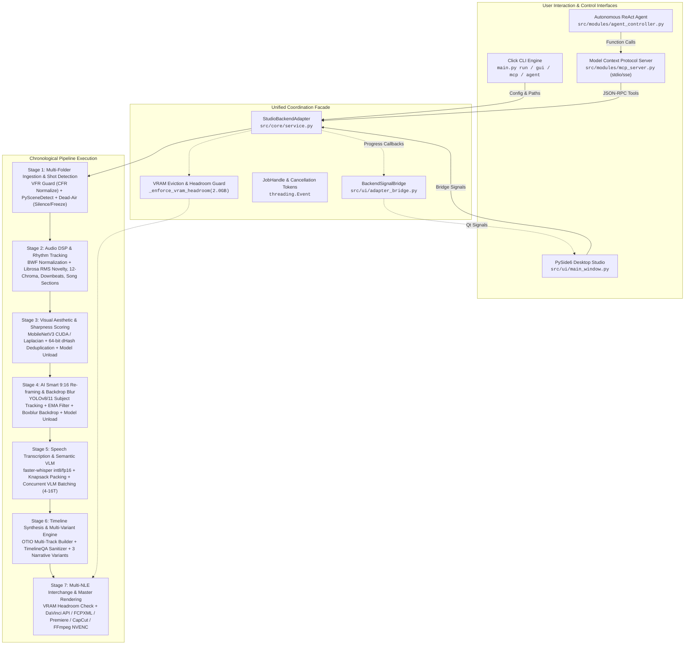
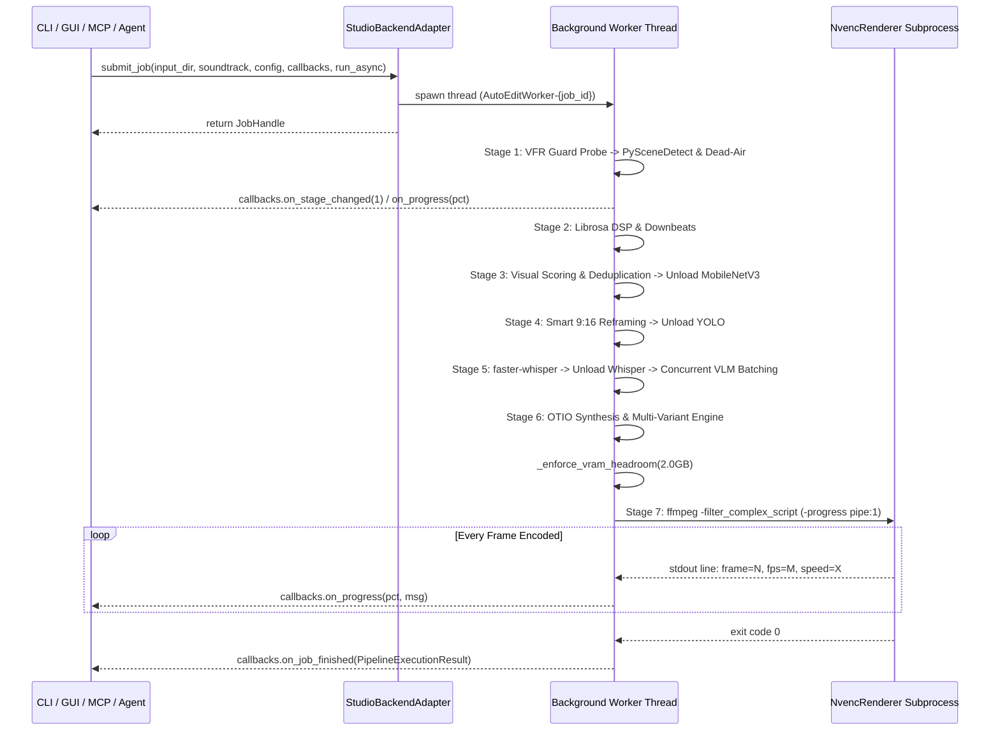

# TECHNICAL HANDOFF DOSSIER: TEAMTRAU-AUTOEDIT ORCHESTRATOR
**Confidential & Proprietary — Engineering Handoff Blueprint**  
**Document Revision:** 2.2.0 (Post-Phase 20: real FCPXML 1.8, Resolve-verified; GUI config/cancel/curation fixes)  
**System Target:** Windows 11 Enterprise (x64), NVIDIA CUDA 12+, NVENC Gen 8 (RTX 3070+), DaVinci Resolve Studio 19/21, PySide6  
**Audience:** Incoming Principal AI Software Architect & Autonomous Coding Agents

---

## EXECUTIVE SUMMARY & SYSTEM TOPOGRAPHY

`TeamTrau-AutoEdit` is a production-grade, non-destructive automated video editing engine and desktop studio. It ingests multi-source raw camera footage (4K/1080p), extracts acoustic and structural musical features from an external soundtrack via DSP, ranks video scenes using neural and heuristic vision pipelines, performs word-level speech-to-text condensation, and synthesizes beat-synchronized multi-track timelines exported to DaVinci Resolve (`.fcpxml`), Adobe Premiere Pro (`.xml`), CapCut Desktop (`draft_content.json`), OpenTimelineIO (`.otio`), and standalone hardware-accelerated HEVC masters via FFmpeg NVENC.

### System Architecture Hierarchy



---

## 1. EXHAUSTIVE MODULE REGISTRY

### 1.1 Core Foundations (`src/core/`)

#### `src/core/types.py`
- **Role:** Immutable domain dataclasses, enums, and typing contracts.
- **Hardware Vector:** CPU-bound (pure Python dataclass runtime).
- **Core Signatures & Dataclasses:**
  * `VideoMetadata`: `path: Path`, `width: int`, `height: int`, `fps: float`, `duration: float`, `total_frames: int`, `codec: str`, `camera_role: str`, `source_folder: Path | None`, `is_vfr: bool = False`. Property `aspect_ratio -> float`.
  * `SceneCut`: `clip_path: Path`, `start_time: float`, `end_time: float`, `start_frame: int`, `end_frame: int`, `duration: float`. Includes validation invariant in `__post_init__` enforcing `end_time >= start_time`.
  * `ActiveSegment`: `start_time: float`, `end_time: float`, `motion_score: float`, `is_active: bool`.
  * `BeatMarker`: `timestamp: float`, `frame_idx: int`, `strength: float`, `is_downbeat: bool`.
  * `SongSection`: `section_type: SongSectionType`, `start_time: float`, `end_time: float`, `duration: float`, `avg_energy: float`, `chroma_profile: list[float]`, `is_climax: bool`.
  * `CropWindow`: `x: int`, `y: int`, `width: int`, `height: int`, `confidence: float`, `tracking_subject: str`.
  * `WordSegment`: `word: str`, `start_time: float`, `end_time: float`, `probability: float`.
  * `SentenceSegment`: `text: str`, `start_time: float`, `end_time: float`, `duration: float`, `words: list[WordSegment]`, `confidence: float`, `importance_score: float`.
  * `SceneVLMAnalysis`: `scene_index: int`, `description: str`, `tags: list[str]`, `mood: str`, `suggested_pacing: str`, `is_key_moment: bool`, `confidence: float`.
  * `ScoredScene`: `scene: SceneCut`, `sharpness_score: float`, `aesthetic_score: float`, `composite_score: float`, `motion_energy: float`, `speed: float`, `crop_window: CropWindow | None`, `vlm_analysis: SceneVLMAnalysis | None`, `camera_role: str`, `metadata: dict[str, Any]`.
  * `TimelineVariant`: `name: str`, `display_name: str`, `description: str`, `target_pacing: str`, `clip_count: int`, `total_duration: float`, `otio_timeline: Any`, `fcpxml_path: Path | None`, `premiere_xml_path: Path | None`, `otio_path: Path | None`, `capcut_draft_path: Path | None`, `render_path: Path | None`, `sequence_scenes: list[ScoredScene]`.
  * `PackedDurationResult`: `selected_sentences: list[SentenceSegment]`, `selected_scenes: list[ScoredScene]`, `total_duration: float`, `target_duration: float`, `speech_ratio: float`, `b_roll_ratio: float`.
  * `PipelineExecutionResult`: Master execution report passed between background threads, UI bridges, and CLI summaries.
- **Dependencies:** Standard library `pathlib`, `typing`, `dataclasses`, `enum`. Downstream: every module in the repository.

#### `src/core/config.py`
- **Role:** Central Pydantic V2 configuration schema, resolution presets registry, and platform discovery.
- **Hardware Vector:** CPU-bound runtime with subprocess hardware probing (`nvidia-smi`, `ffmpeg -encoders`).
- **Core Signatures:**
  * `class PipelineConfig(BaseModel)`: Central configuration model containing 50+ hyper-parameters (canvas geometry, threshold curves, NVENC bitrates, VLM endpoints, subtitle styles, `auto_normalize_vfr: bool = True`, `vlm_concurrency: int = 4`).
  * `PRESETS: Final[dict[str, RenderPreset]]`: Standard presets (`1080p30`, `1080p60`, `1080p24`, `4k30`, `4k60`, `4k24`, `social_vertical`, `social_vertical_60`, `cinema_4k`).
  * `check_cuda_available() -> bool`: Probes PyTorch CUDA runtime with `nvidia-smi` fallback.
  * `check_nvenc_available() -> bool`: Runs `ffmpeg -hide_banner -encoders` checking for `hevc_nvenc`.
  * `find_default_resolve_script_path() -> Path`, `find_default_resolve_exe() -> Path`: Windows Registry / Program Files paths for DaVinci Resolve Studio.
- **Dependencies:** `pydantic`, `src.core.types`. Downstream: all processing modules and UI widgets.

#### `src/core/ontology.py`
- **Role:** Camera taxonomy, multi-folder ingestion metadata, and directory-based role inference.
- **Hardware Vector:** CPU-bound.
- **Core Signatures:**
  * `class CameraRole(str, Enum)`: `CAM_A`, `CAM_B`, `DRONE`, `ACTION_CAM`, `GOPRO`, `SMARTPHONE`, `B_ROLL`.
  * `infer_camera_role(path: Path) -> CameraRole`: Lexical pattern matcher identifying camera tags from folder or file naming conventions (`drone`, `dji`, `gopro`, `pov`, `hero`, `cam_a`, `wide`, `broll`).
  * `get_role_display_name(role: CameraRole | str) -> str`: Human-readable label generator for UI dropdowns.
- **Dependencies:** `src.core.types`. Downstream: `MediaBrowserWidget`, `IngestDetector`, `ProjectManager`.

#### `src/core/analysis_cache.py`, `src/core/project_io.py`, `src/core/ffmpeg_utils.py`
- **Role:** Disk cache for per-clip analysis results (repeat runs skip recomputation: analysis 33.6s -> 1.8s cached); `.tteproj` read/write helpers used by Edit/Deliver; shared FFmpeg subprocess and probe helpers.
- **Dependencies:** `src.core.types`. Downstream: `StudioBackendAdapter`, `ProjectManager`, `NvencRenderer`.

#### `src/core/genre_presets.py`
- **Role:** Multi-genre editorial ontology matrix covering 4 Major Genres and 23 Sub-genres.
- **Hardware Vector:** CPU-bound.
- **Core Signatures:**
  * `class GenrePreset(BaseModel)`: Preset definitions containing pacing curves, motion thresholds, reframing styles, and audio drop mappings. Method `apply(config: PipelineConfig) -> None` mutates target config dynamically.
  * `GENRE_PRESETS_MATRIX: Final[dict[str, GenrePreset]]`: Matrix spanning Action & Sports (Automotive, Extreme Sports, Fight/Martial Arts), Travel & Lifestyle (Luxury Travel, Vlog, Culinary/Foodie), Commercial & Social (TikTok Fashion, Tech Showcase), and Documentary & Narrative (Cinematic Story, Nature Wildlife).
  * `find_preset_for_audio(bpm: float, energy: float) -> GenrePreset`: Heuristic classifier finding best matching genre based on music tempo and RMS variance.
- **Dependencies:** `pydantic`, `src.core.config`. Downstream: `GenreRecommender`, `MediaBrowserWidget`.

#### `src/core/service.py`
- **Role:** Central unified facade orchestrating synchronous and asynchronous pipeline jobs across CLI, GUI, and MCP.
- **Hardware Vector:** Multithreaded orchestration coordinator with VRAM monitoring and garbage collection hooks.
- **Core Signatures:**
  * `_enforce_vram_headroom(max_allowed_gb: float = 2.0) -> None`: Probes `torch.cuda.memory_allocated()` and triggers aggressive garbage collection and `torch.cuda.empty_cache()` before NVENC hardware encoding.
  * `class JobCallbacks`: Dataclass containing optional function pointers: `on_stage_changed`, `on_progress`, `on_scene_discovered`, `on_scenes_tagged`, `on_log`.
  * `class JobHandle`: Thread handle tracking execution status (`is_running()`, `cancel()`, `wait(timeout)`).
  * `class StudioBackendAdapter`: Primary service facade exposing:
    - `probe_media(file_path: Path, config: PipelineConfig | None) -> VideoMetadata`
    - `quick_analyze_audio(audio_path: Path, config: PipelineConfig | None) -> AudioAnalysisResult`
    - `detect_scenes(video_path: Path, ...) -> list[SceneCut]`
    - `reframe_video(video_path: Path, ...) -> list[CropWindow]`
    - `ping_ai_endpoint(config: PipelineConfig | None) -> tuple[bool, float, str]`
    - `submit_job(...) -> JobHandle` (Synchronous or Threaded worker)
    - `_execute_pipeline(...) -> PipelineExecutionResult`: Master 7-stage sequential executor with VFR normalization and stage-by-stage neural model unloading.
- **Dependencies:** `src.core.types`, `src.core.config`, all processing modules in `src/modules/` and `src/dispatchers/`. Downstream: `main.py`, `src.ui.main_window`, `src.modules.mcp_server`.

---

### 1.2 Pipeline Processing Modules (`src/modules/`)

#### `src/modules/ingest_detector.py`
- **Role:** Non-destructive shot boundary detection, automated VFR detection, CFR normalization, dead-air filtering, and metadata export.
- **Hardware Vector:** CPU-bound OpenCV decoding + FFmpeg subprocess filter acceleration.
- **Core Signatures:**
  * `class IngestDetector`:
    - `probe_video(video_path: Path, ...) -> VideoMetadata`: Uses `ffprobe` stream inspection comparing `r_frame_rate` against `avg_frame_rate` to set `is_vfr: bool`.
    - `normalize_to_cfr(video_path: Path, target_fps: float = 30.0, ...) -> Path`: Executes fast non-destructive FFmpeg transcode (`-c:v libx264 -preset ultrafast -crf 17 -vsync cfr -r {target_fps} -c:a copy`) with disk caching.
    - `detect_scenes(video_path: Path) -> list[SceneCut]`: Adaptive threshold shot detection via PySceneDetect `AdaptiveDetector`.
    - `detect_silence_ranges(video_path: Path) -> list[tuple[float, float]]`: FFmpeg native `silencedetect=noise=-35dB:d=3.0` filter.
    - `detect_freeze_ranges(video_path: Path) -> list[tuple[float, float]]`: FFmpeg native `freezedetect=noise=0.02:d=3.0` filter.
    - `filter_scenes_by_dead_air(...) -> list[SceneCut]`: Intersects scenes with silence and freeze intervals, flagging or discarding dead-air.
    - `batch_process_videos(...) -> list[SceneCut]`: Multithreaded parallel ingestion across raw camera files using `ThreadPoolExecutor`.
    - `export_metadata_csv(...)`, `export_metadata_edl(...)`: Non-destructive CMX 3600 EDL and CSV interchange serialization.
- **Dependencies:** `scenedetect`, `cv2`, `numpy`, `shutil`, `subprocess`. Downstream: `StudioBackendAdapter`.

#### `src/modules/audio_analyzer.py`
- **Role:** Acoustic DSP feature extraction, tempo estimation, downbeat isolation, and song section classification.
- **Hardware Vector:** CPU-bound NumPy/SciPy/Librosa DSP computations.
- **Core Signatures:**
  * `class AudioAnalyzer`:
    - `_load_audio(audio_path: Path) -> tuple[np.ndarray, int]`: Resamples soundtrack to 22.05kHz mono waveform.
    - `compute_energy_profile(...) -> tuple[np.ndarray, np.ndarray, np.ndarray, np.ndarray, np.ndarray]`: Extracts continuous RMS energy, spectral novelty, and 12-dimensional chroma profiles.
    - `detect_song_sections(...) -> list[SongSection]`: Classifies track into `INTRO`, `BUILDUP`, `DROP`, and `OUTRO` based on dynamic energy thresholds and spectral variance.
    - `analyze(audio_path: Path, target_duration, available_footage_duration, duration_mode) -> AudioAnalysisResult`: Tracks beats with `librosa.beat.beat_track`, downbeat phase isolation (4/4 bar alignment), and structural micro-cut filtering (0.8s in verse, 0.4s in climax).
- **Dependencies:** `librosa`, `soundfile`, `scipy`, `numpy`. Downstream: `StudioBackendAdapter`, `GenreRecommender`.

#### `src/modules/audio_normalizer.py`
- **Role:** Non-destructive BWF metadata stripping and 24-bit PCM WAV normalization.
- **Hardware Vector:** FFmpeg CPU subprocess.
- **Core Signatures:**
  * `class AudioNormalizer`:
    - `clean_audio(input_path: Path) -> Path`: Executes `ffmpeg -i input -map_metadata -1 -c:a pcm_s24le -ar 48000 out.wav` to strip corrupted Broadcast Wave Format (BWF) timecodes and standardize audio.
- **Dependencies:** `shutil`, `subprocess`. Downstream: `StudioBackendAdapter`.

#### `src/modules/visual_scorer.py`
- **Role:** Keyframe extraction, Tenengrad/Laplacian sharpness evaluation, PyTorch aesthetic scoring, dHash deduplication, and memory eviction.
- **Hardware Vector:** NVIDIA CUDA 12+ Float16 (MobileNetV3) with automatic CPU OpenCV fallback.
- **Core Signatures:**
  * `compute_dhash(image: np.ndarray, hash_size: int = 8) -> str`: 64-bit difference hash string.
  * `hamming_distance(hash1: str, hash2: str) -> int`: Fast XOR bit count.
  * `class VisualScorer`:
    - `_init_aesthetic_model()`: Loads `torchvision.models.mobilenet_v3_small` onto CUDA device.
    - `unload_model()`: Deletes PyTorch models and transforms, invokes `gc.collect()`, and executes `torch.cuda.empty_cache()` to evict memory.
    - `_compute_sharpness(img: np.ndarray) -> float`: Normalized Laplacian variance $\sigma^2$ with log scaling.
    - `_compute_aesthetic(img: np.ndarray) -> float`: Evaluates deep visual features or OpenCV contrast/colorfulness/rule-of-thirds heuristics.
    - `deduplicate_scenes(scenes: list[ScoredScene], threshold: int = 6) -> list[ScoredScene]`: Prunes duplicate camera angles and identical static setups using Hamming distance.
    - `calculate_speed_for_score(composite_score: float) -> float`: Dynamic speed ramping (1x - 8x variable playback).
- **Dependencies:** `torch`, `torchvision`, `cv2`, `numpy`. Downstream: `StudioBackendAdapter`.

#### `src/modules/smart_reframer.py`
- **Role:** AI 9:16 pan-and-scan subject tracking, dual-layer blurred backdrop generator, and YOLO model eviction.
- **Hardware Vector:** NVIDIA CUDA 12+ (YOLOv8/11 inference) + FFmpeg filtergraph.
- **Core Signatures:**
  * `class SmartReframer`:
    - `unload_model()`: Deletes YOLO model reference, invokes garbage collection, and calls `torch.cuda.empty_cache()`.
    - `detect_subject_centers(frame: np.ndarray) -> list[tuple[float, float, float]]`: Runs YOLO person class detection on keyframes.
    - `calculate_crop_window(...) -> CropWindow`: Computes 9:16 target window with Exponential Moving Average (EMA, $\alpha=0.20$) camera smoothing.
    - `reframe_all_scenes(scenes: list[ScoredScene], ...) -> list[ScoredScene]`: Injects `CropWindow` metadata into every scene.
    - `build_backdrop_filter_graph(...) -> str`: Assembles dynamic FFmpeg dual-layer graph: blurred background (`boxblur=20:5`, eq brightness -15%) + centered/tracked foreground.
- **Dependencies:** `ultralytics` (optional/lazy), `cv2`, `numpy`. Downstream: `StudioBackendAdapter`, `NvencRenderer`.

#### `src/modules/transcription_engine.py`
- **Role:** Automatic Speech Recognition (ASR) with word-level timestamps, audio ducking detection, and CTranslate2 eviction.
- **Hardware Vector:** CTranslate2 CUDA Float16 / int8 computation with CPU fallback.
- **Core Signatures:**
  * `class TranscriptionEngine`:
    - `unload_model()`: Deletes faster-whisper model reference and releases CUDA memory allocations.
    - `transcribe_file(video_or_audio_path: Path) -> list[SentenceSegment]`: Executes `faster_whisper.WhisperModel` with `word_timestamps=True`, grouping words into grammatical sentence blocks with confidence scores.
- **Dependencies:** `faster_whisper`. Downstream: `StudioBackendAdapter`.

#### `src/modules/duration_packer.py`
- **Role:** 0-1 Knapsack dynamic programming duration solver balancing dialogue preservation with visual B-roll pacing.
- **Hardware Vector:** CPU-bound algorithmic optimization ($O(N \cdot W)$).
- **Core Signatures:**
  * `class DurationPacker`:
    - `pack_timeline(sentences, scored_scenes, target_duration) -> PackedDurationResult`: Solves knapsack optimization maximizing sentence importance scores and scene aesthetic scores within strict time budgets.
- **Dependencies:** `src.core.types`. Downstream: `StudioBackendAdapter`.

#### `src/modules/visual_flow.py`
- **Role:** Visual continuity guard, Ken Burns ambient motion generator, and 0-byte video guard.
- **Hardware Vector:** CPU-bound OpenCV histogram comparisons.
- **Core Signatures:**
  * `extract_frame_at_timestamp(video_path: Path, timestamp: float) -> np.ndarray | None`: Safely extracts video frame, with strict guard against 0-byte video files to prevent Windows Media Foundation hangs.
  * `evaluate_cut_continuity(scene_a, scene_b, threshold=0.45) -> tuple[float, bool]`: Computes Bhattacharyya distance across normalized 64-bin Y-channel histograms. Flagged cuts trigger automatic 10-frame cross-dissolves.
  * `assign_ambient_motion(scene, clip_index, motion_threshold=0.20) -> dict[str, Any]`: Computes subtle Ken Burns zoompan (`1.0x -> 1.05x`) for static scenes with motion energy below threshold.
- **Dependencies:** `cv2`, `numpy`. Downstream: `TimelineBuilder`.

#### `src/modules/kinetic_subtitle.py` & `subtitle_formatter.py`
- **Role:** High-retention kinetic typography generation (ASS) and clean SRT serialization.
- **Hardware Vector:** CPU-bound text formatting.
- **Core Signatures:**
  * `export_kinetic_ass(sentences, output_path, is_vertical=True, margin_v=320) -> Path`: Compiles Advanced SubStation Alpha (`.ass`) scripts with word-level highlighting (`{\c&H0000FFFF&}`), 72pt Montserrat font, and safe-zone positioning.
  * `export_clean_srt(sentences, output_path, max_cpl=37) -> Path`: Standard SRT file export.
- **Dependencies:** `src.core.types`. Downstream: `StudioBackendAdapter`.

#### `src/modules/timeline_qa.py`
- **Role:** Automated sequence sanitization and boundary artifact elimination.
- **Hardware Vector:** CPU-bound OpenTimelineIO traversal.
- **Core Signatures:**
  * `class TimelineQA`:
    - `validate_and_sanitize(timeline, min_clip_frames=6) -> list[str]`: Enforces flash-frame elimination (clamps clips < 6 frames) and injects 20ms audio crossfades at clip boundaries to eliminate audio pops.
- **Dependencies:** `opentimelineio`. Downstream: `StudioBackendAdapter`.

#### `src/modules/timeline_builder.py`
- **Role:** Multi-track OpenTimelineIO timeline synthesizer and NLE interchange exporter.
- **Hardware Vector:** CPU-bound OTIO composition and XML serialization.
- **Core Signatures:**
  * `class TimelineBuilder`:
    - `build_timeline(scored_scenes, cut_timestamps, soundtrack_path, ...) -> otio.schema.Timeline`: Builds multi-track sequence (Track V2 Teaser Hook, Track V1 Master Sequence, Track A1 Soundtrack).
    - `export_fcpxml(...) -> Path`: Exports DaVinci Resolve FCPXML 1.8 via `fcpxml_exporter` (the old FCP 7 XML written into a `.fcpxml` file is gone).
    - `export_premiere_xml(...) -> Path`: Exports Adobe Premiere Pro XML.
    - `export_all(...) -> TimelineExportResult`: Exports FCPXML, Premiere XML, OTIO, and triggers CapCut draft export.
- **Dependencies:** `opentimelineio`, `xml.etree.ElementTree`. Downstream: `StudioBackendAdapter`, `VariantSynthesizer`.

#### `src/modules/edit_timeline.py`
- **Role:** Edit-stage timeline operations on the analysed OTIO timeline: scene curation (`apply_scene_curation` replaces clips from excluded scenes, keeps beat grid and manual edits), clip move/delete used by the GUI undo stack.
- **Dependencies:** `opentimelineio`, `src.core.types`. Downstream: `main_window.py`, `project_manager.py`, `StudioBackendAdapter`.

#### `src/modules/keyframe_cache.py`
- **Role:** Shared keyframe sweep: one decode pass feeds sharpness, aesthetic, dedup and reframing stages instead of each stage re-decoding the video.
- **Dependencies:** `cv2`, `numpy`. Downstream: `VisualScorer`, `SmartReframer`, `StudioBackendAdapter`.

#### `src/modules/fcpxml_exporter.py`
- **Role:** Native FCPXML 1.8 writer for DaVinci Resolve, built straight from the OTIO timeline (`fa8589c`).
- **Hardware Vector:** CPU-bound XML serialization.
- **Core Behavior:** Exact rational times; asset-clip spine; `timeMap` speed ramps (linear segments through origin, `start = in-point/speed`); gaps; cross-dissolve; music as connected lane -1 with camera audio ducked/muted; rough-cut markers; percent-encoded unicode URLs. Audio clips carry an `AutoEdit` role (`music` / `camera_audio`) instead of name matching.
- **Dependencies:** `xml.etree.ElementTree`, `opentimelineio`. Downstream: `TimelineBuilder.export_fcpxml`, `ResolveDispatcher`.

#### `src/modules/capcut_exporter.py`
- **Role:** Native CapCut Desktop project draft generator (`draft_content.json` & `draft_meta_info.json`).
- **Hardware Vector:** CPU-bound JSON serialization.
- **Core Signatures:**
  * `class CapCutExporter`:
    - `export_timeline(otio_timeline, draft_dir, draft_name) -> Path`: Translates OTIO tracks into native CapCut tracks, materials, and canvas definitions with microsecond ($10^{-6}$s) precision timecodes.
- **Dependencies:** `json`, `uuid`, `opentimelineio`. Downstream: `TimelineBuilder`.

#### `src/modules/variant_synthesizer.py`
- **Role:** Multi-variant timeline synthesis engine producing up to 3 distinct narrative cuts from the same footage pool.
- **Hardware Vector:** CPU-bound OTIO assembly.
- **Core Signatures:**
  * `class MultiVariantTimelineSynthesizer`:
    - `synthesize_variants(scored_scenes, beats, soundtrack_path, variant_count=3, ...) -> dict[str, TimelineVariant]`: Produces `beat_driven` (standard music sync), `cinematic` (longer takes, high aesthetic weight), and `social_teaser` (rapid cuts, hook-first, vertical crop).
- **Dependencies:** `opentimelineio`, `src.modules.timeline_builder`. Downstream: `StudioBackendAdapter`.

#### `src/modules/genre_recommender.py`
- **Role:** Smart genre classifier combining audio DSP features with local LLM/heuristic reasoning.
- **Hardware Vector:** CPU-bound Librosa DSP + optional HTTP LLM inference.
- **Core Signatures:**
  * `class GenreRecommender`:
    - `recommend_preset(soundtrack_path, scenes) -> tuple[GenrePreset, float, str]`: Analyzes soundtrack BPM, spectral contrast, and RMS variance to match against `GENRE_PRESETS_MATRIX`.
- **Dependencies:** `librosa`, `src.core.genre_presets`. Downstream: `MediaBrowserWidget`.

#### `src/modules/vlm_assistant.py`
- **Role:** Concurrent Vision-Language Model (VLM) client for semantic scene tagging, mood detection, and pacing recommendations.
- **Hardware Vector:** Cloud API (OpenRouter/OpenAI) or Local LAN (Ollama/LM Studio) REST calls via multithreaded worker pool.
- **Core Signatures:**
  * `class VLMAssistant`:
    - `extract_keyframe(clip_path: Path, timestamp_sec: float) -> np.ndarray | None`: OpenCV frame grabber.
    - `analyze_scene(frame: np.ndarray, scene_index: int, ...) -> SceneVLMAnalysis`: Encodes JPEG to base64, dispatches structured prompt to `/v1/chat/completions`, and parses JSON response with heuristic fallback.
    - `tag_scored_scenes(scenes: list[ScoredScene], keyframes=None, concurrency=4) -> list[ScoredScene]`: Executes concurrent scene tagging using `ThreadPoolExecutor` with per-request timeout guard, graceful fallback, and strict output order preservation.
- **Dependencies:** `httpx`, `cv2`, `base64`, `concurrent.futures`. Downstream: `StudioBackendAdapter`.

#### `src/modules/mcp_server.py` & `agent_controller.py`
- **Role:** Universal Model Context Protocol (MCP) server (FastMCP) exposing 23 tools + Autonomous ReAct Agent controller.
- **Hardware Vector:** Network I/O / JSON-RPC.
- **Core Signatures:**
  * MCP Server: Standard tools (`probe_media`, `detect_scenes`, `analyze_soundtrack`, `reframe_video`, `build_timeline`, `render_master`, `validate_timeline_qa`, `get_genre_recommendation`). Transports: `stdio` and `sse`.
  * `class AutoEditAgentController`: ReAct reasoning loop with tool execution, streaming callbacks, and heuristic offline planner.
- **Dependencies:** `mcp`, `openai`, `src.core.service`. Downstream: `main.py`, external agents (Antigravity, Claude, Cursor).

---

### 1.3 Hardware Dispatchers (`src/dispatchers/`)

#### `src/dispatchers/nvenc_renderer.py`
- **Role:** Headless video rendering engine compiling dynamic FFmpeg `filter_complex_script` and executing hardware-accelerated HEVC NVENC encoding.
- **Hardware Vector:** NVIDIA NVENC Gen 8 (`hevc_nvenc` preset `p7`, CQ 18, configurable bitrate) with CPU `libx265` fallback.
- **Core Signatures:**
  * `class NvencRenderer`:
    - `render_sequence(scored_scenes, cut_timestamps, soundtrack_path, output_file, ...) -> RenderJobResult`:
      * Assembles dynamic multi-input FFmpeg script bypassing Windows 8191 CLI character limits.
      * Injects crop parameters (`crop=w:h:x:y`), speed ramping filters (`setpts=PTS/N`), watermarks, and retention teasers.
      * Spawns `subprocess.Popen` with `-progress pipe:1` for live frame/speed progress parsing.
      * Manages dedicated `_drain_stderr` background thread preventing OS buffer deadlocks.
      * Handles cooperative cancellation via `cancel_event.is_set()` with graceful `proc.terminate()` and timeout `kill()`.
- **Dependencies:** `subprocess`, `threading`, `shutil`. Downstream: `StudioBackendAdapter`.

#### `src/dispatchers/resolve_dispatcher.py` & `resolve_worker.py`
- **Role:** DaVinci Resolve Studio automation client via Windows Scripting API (`fusionscript.dll`).
- **Hardware Vector:** External process IPC via Blackmagic Design DaVinciResolveScript.
- **Core Signatures:**
  * `class ResolveDispatcher`:
    - `dispatch_project(fcpxml_path, source_media_paths, project_name, ...) -> dict[str, Any]`: Binds to running Resolve Studio, creates a **new** project (never reconfigures the user's open one), keeps NTSC rates (29.97 / 23.976), imports FCPXML, populates media pool, queues deliverables.
    - Falls back to `resolve_worker.py` in a subprocess under a Python that fusionscript supports (3.13 on the reference machine; the 3.11 venv cannot load it).
- **Dependencies:** `DaVinciResolveScript`. Downstream: `StudioBackendAdapter`.

#### `src/dispatchers/watermark_helper.py`
- **Role:** Filtergraph generator for brand watermark positioning, opacity, and margins.
- **Hardware Vector:** CPU-bound filter construction.
- **Core Signatures:**
  * `build_watermark_filter_lines(wm_input_idx, base_v_label, out_v_label, config, canvas_w, canvas_h) -> list[str]`: Computes coordinate math (`main_w-overlay_w-margin`, `overlay_h`, `format=rgba,colorchannelmixer=aa=opacity`).
- **Dependencies:** `src.core.types`. Downstream: `NvencRenderer`.

---

### 1.4 Desktop Studio GUI Layer (`src/ui/`)

- `src/ui/app.py`: High-DPI application bootstrap configuring dark studio theme (`dark_studio.qss`) and Qt event loop.
- `src/ui/adapter_bridge.py`: Thread-safe `BackendSignalBridge` routing backend worker callbacks to Qt signals.
- `src/ui/main_window.py`: Single-window nested `QSplitter` NLE architecture:
  * Upper Left: `MediaBrowserWidget` (Multi-folder queue, camera roles, metadata table, AI preset banner).
  * Upper Center: `PlayerWidget` (OpenCV live video program monitor, 9:16 HUD guide overlay, SMPTE readout, J-K-L transport).
  * Upper Right: `InspectorPanelWidget` (Workflow presets, duration slider, speed ramping, watermark, Ken Burns zoom factor spinbox, AI engine toggles).
  * Lower: `TimelineViewWidget` (Multi-track canvas with V2 teaser, V1 master, A1 soundtrack, song section blocks, beat markers, variant switcher bar).
- `src/ui/controllers/project_manager.py`: Workspace session persistence (`.tteproj` v2.0.0 JSON) serializing complete state (media, roles, scored scenes with VLM/dHash, audio sections, timeline variants, in/out marks).
- `src/ui/controllers/shortcut_manager.py`: Centralized NLE keyboard shortcuts with strict Focus Guard invariant protecting text inputs.
- `src/ui/widgets/settings_dialog.py`: 5-tab preferences modal (AI & LLM Hub, Ingest & Dead-Air, Audio & Normalization, Subtitles & Whisper, AI Agent & MCP Hub) with persistent JSON storage.
- `src/ui/widgets/export_panel.py`: Export panel equipped with collapsible/checkable `Advanced NVENC Quality Overrides` (Target Bitrate 10-200 Mbps, Constant Quality CQ 1-35) and live render monitoring.
- `src/ui/widgets/export_dialog.py`: Sleek modal dialog wrapping `ExportPanelWidget`.

---

## 2. OPERATIONAL WORKFLOWS & EXECUTION TOPOLOGIES

### 2.1 Unified Service Layer Routing

All entry points—CLI (`main.py run`), Desktop GUI (`main.py gui`), MCP Server (`main.py mcp`), and Autonomous Agent (`main.py agent`)—delegate to `StudioBackendAdapter` in `src/core/service.py`.



### 2.2 Threading & Concurrency Model

1. **GUI Signal Decoupling:** `BackendSignalBridge` subclasses `QObject`. When `StudioBackendAdapter` worker invokes callbacks from its background thread, Qt signals (`stage_changed`, `progress_updated`, `scene_discovered`, `job_finished`) automatically marshal data across thread boundaries to the Qt main GUI thread via queued connections.
2. **ThreadPool Isolation:**
   - Background video metadata probing in `MediaBrowserWidget` uses `QThreadPool.globalInstance().start(ProbeRunnable)`.
   - Keyframe thumbnail extraction in `SceneGridWidget` uses `ThumbnailRunnable` queued in `QThreadPool`.
   - VLM semantic scene tagging executes over `concurrent.futures.ThreadPoolExecutor` with configurable concurrency (4-16 workers) and per-request latency timeouts.
3. **FFmpeg Subprocess Streaming:**
   - Dynamic `filter_complex_script` written to disk avoids Windows command-line limit (8191 characters).
   - Execution uses `subprocess.Popen(..., stdout=subprocess.PIPE, stderr=subprocess.PIPE, text=True)`.
   - A dedicated daemon thread `_drain_stderr` constantly reads `proc.stderr` lines into a buffer to prevent deadlocks when stderr pipes fill up.
   - Stdout is parsed line-by-line reading `-progress pipe:1` keys (`out_time_ms`, `frame`, `fps`, `speed`).
4. **Cooperative Cancellation & VRAM Eviction:**
   - A single `threading.Event` (`cancel_event`) is checked at every stage boundary.
   - Stage-by-stage model eviction: `VisualScorer.unload_model()`, `SmartReframer.unload_model()`, and `TranscriptionEngine.unload_model()` are sequentially triggered immediately after their respective stages finish.
   - Before Stage 7 hardware encoding, `_enforce_vram_headroom(2.0GB)` verifies low VRAM allocation, executing aggressive Python garbage collection and `torch.cuda.empty_cache()` to guarantee headroom for NVENC dual-surface 4K encoding.

---

## 3. TEST BASELINE & QUALITY INVARIANTS

### 3.1 Verified Test Suite Mapping (315 collected; 314 passing on last full run)

Last full run (`pytest tests -q`): 314 passed, 1 failed. The failure is `tests/test_service_adapter.py::test_adapter_submit_job_async_and_cancel`, which passes when run alone. It is flaky under full-suite load and not yet root-caused. Treat as open, not as a regression that was fixed.

Per-module mapping below. Rows added in 2.2.0 are the new GUI, FCPXML, Resolve, cache and concurrency suites:

| Test Suite File | Covered Module | Test Count | Key Verification Objectives |
|:---|:---|:---:|:---|
| `test_agent_cli_and_gui.py` | `main.py`, `src/ui/app.py` | 5 | Agent CLI argument parsing, dry-run GUI flags, menu bar bindings |
| `test_agent_controller.py` | `src/modules/agent_controller.py` | 6 | ReAct function-calling loop, heuristic fallback, error handling |
| `test_audio_analyzer.py` | `src/modules/audio_analyzer.py` | 2 | Librosa BPM tempo estimation, downbeat cuts, micro-cut filtering |
| `test_audio_normalizer.py` | `src/modules/audio_normalizer.py` | 8 | BWF metadata stripping, 24-bit PCM WAV normalization, cache hits |
| `test_audio_structure.py` | `src/modules/audio_analyzer.py` | 6 | Song sections (`INTRO`, `BUILDUP`, `DROP`, `OUTRO`), duration modes |
| `test_capcut_exporter.py` | `src/modules/capcut_exporter.py` | 3 | CapCut `draft_content.json`, microsecond timecodes, track layout |
| `test_config.py` | `src/core/config.py` | 4 | Preset definitions, Pydantic validation, resolution overrides |
| `test_duration_packer.py` | `src/modules/duration_packer.py` | 3 | Knapsack duration solver, dialogue-to-B-roll ratio allocation |
| `test_edit_deliver_gui.py` | `src/ui/main_window.py`, `timeline_view.py` | 10 | Edit/Deliver split in Desktop Studio, Timeline ready state, export gating |
| `test_export_panel.py` | `src/ui/widgets/export_panel.py` | 10 | Multi-NLE export checkboxes, NVENC bitrate/CQ overrides, render monitor |
| `test_fcpxml_exporter.py` | `src/modules/fcpxml_exporter.py` | 9 | FCPXML 1.8 structure, exact rational times, timeMap ramps, unicode URLs, audio roles |
| `test_gui_config_precedence.py` | `src/ui/main_window.py` | 7 | Single `_build_config()`: Rough Cut, Apply Preset, Export honour UI state |
| `test_keyframe_cache.py` | `src/modules/keyframe_cache.py` | 7 | Shared keyframe sweep correctness and reuse across stages |
| `test_pipeline_concurrency.py` | `src/core/service.py` | 4 | Audio/whisper overlap, cancellation during concurrent stages |
| `test_scene_curation_and_cancel.py` | `edit_timeline.py`, `service.py` | 7 | Scene curation applied to timeline, "Cancelled" vs "Failed" result |
| `test_genre_presets.py` | `src/core/genre_presets.py` | 3 | 23-genre matrix integrity, dynamic `apply()` mutations |
| `test_genre_recommender.py` | `src/modules/genre_recommender.py` | 4 | DSP audio feature matching, 1-click UI recommendation banner |
| `test_gui_shell.py` | `src/ui/main_window.py` | 6 | PySide6 window shell, dark theme loading, status bar updates |
| `test_ingest_detector.py` | `src/modules/ingest_detector.py` | 7 | PySceneDetect adaptive thresholding, dead-air filtering, EDL/CSV |
| `test_inspector_and_player.py` | `src/ui/widgets/player_widget.py` | 10 | Live video player, 9:16 HUD guide, Ken Burns zoom slider, inspector tabs |
| `test_kinetic_subtitles.py` | `src/modules/kinetic_subtitle.py` | 4 | ASS script styling, karaoke color tags, vertical safe zones |
| `test_mcp_comprehensive.py` | `src/modules/mcp_server.py` | 6 | 23 MCP tools execution, prompt templates, resource catalogs |
| `test_mcp_server.py` | `src/modules/mcp_server.py` | 6 | FastMCP stdio/sse protocol, JSON-RPC serialization |
| `test_media_browser.py` | `src/ui/widgets/media_browser.py` | 8 | Drag-and-drop ingestion, path pickers, camera role assignment |
| `test_multifolder_ingest.py` | `src/core/ontology.py`, `service.py` | 2 | Multi-directory queue, deduplication across folder inputs |
| `test_nle_menus_and_workflow.py` | `src/ui/main_window.py` | 5 | Edit menu, clipboard cut/copy/paste, undo/redo stack |
| `test_nvenc_renderer.py` | `src/dispatchers/nvenc_renderer.py` | 5 | Dynamic filtergraph generation, NVENC flags, CPU fallback |
| `test_pipeline_e2e.py` | End-to-End Orchestrator | 5 | Complete synthetic pipeline run: FCPXML, Premiere, NVENC render |
| `test_project_manager.py` | `src/ui/controllers/project_manager.py` | 5 | `.tteproj` v2.0.0 serialization, deserialization, dirty state |
| `test_resolve_dispatcher.py` | `src/dispatchers/resolve_dispatcher.py`, `resolve_worker.py` | 6 | DaVinci Resolve Studio API client, new-project creation, NTSC rates, worker fallback |
| `test_scene_grid.py` | `src/ui/widgets/scene_grid.py` | 12 | Thumbnail grid, sharpness/aesthetic badges, include toggles |
| `test_service_adapter.py` | `src/core/service.py` | 7 | Sync/async submission, callback streaming, job cancellation |
| `test_settings_dialog.py` | `src/ui/widgets/settings_dialog.py` | 6 | 5-tab preferences persistence, async test ping, JSON config |
| `test_shortcut_manager.py` | `src/ui/controllers/shortcut_manager.py` | 5 | J-K-L shuttle, I/O marking, focus guard widget protection |
| `test_smart_reframer.py` | `src/modules/smart_reframer.py` | 8 | YOLO tracking, EMA smoothing, blurred backdrop dual-layer |
| `test_speed_ramping.py` | `src/modules/visual_scorer.py` | 3 | 1x-8x speed mapping, dynamic setpts filter assembly |
| `test_timeline_builder.py` | `src/modules/timeline_builder.py` | 6 | OTIO multi-track synthesis, teaser hook, FCPXML / Premiere XML |
| `test_timeline_qa.py` | `src/modules/timeline_qa.py` | 2 | Flash-frame clamp (<6 frames), 20ms audio pop crossfade |
| `test_timeline_view.py` | `src/ui/widgets/timeline_view.py` | 8 | Timeline canvas painting, track layout, scrubbing, zoom |
| `test_transcription_engine.py` | `src/modules/transcription_engine.py` | 4 | faster-whisper mocking, word timestamps, sentence grouping |
| `test_variant_synthesizer.py` | `src/modules/variant_synthesizer.py` | 2 | 3 creative variants generation (`beat_driven`, `cinematic`, `social`) |
| `test_vfr_normalization.py` | `src/modules/ingest_detector.py` | 4 | Automated VFR detection via `ffprobe`, CFR normalization pass, cache hits |
| `test_visual_flow.py` | `src/modules/visual_flow.py` | 5 | Bhattacharyya distance, cross-dissolve, Ken Burns zoompan |
| `test_visual_scorer.py` | `src/modules/visual_scorer.py` | 5 | Laplacian sharpness, MobileNetV3 / OpenCV, dHash deduplication |
| `test_vlm_assistant.py` | `src/modules/vlm_assistant.py` | 6 | OpenAI REST protocol, prompt schemas, heuristic fallback |
| `test_vlm_concurrency.py` | `src/modules/vlm_assistant.py` | 2 | ThreadPoolExecutor concurrent batching, timeout fallbacks, order preservation |
| `test_vram_cleanup.py` | `src/core/service.py`, neural modules | 4 | Sequential VRAM eviction across stages, `_enforce_vram_headroom` |
| `test_watermark.py` | `src/dispatchers/watermark_helper.py` | 4 | Watermark coordinates math, opacity overlays |

### 3.2 Mocking Strategies & Quality Invariants

- **FFmpeg Subprocess Mocks:** Tests mock `subprocess.Popen` and `subprocess.run` yielding synthetic stdout lines simulating `-progress pipe:1` progress events without requiring FFmpeg binaries during CI.
- **0-Byte Video Guard:** `extract_frame_at_timestamp` safely checks `stat().st_size == 0` avoiding Windows DirectShow/Media Foundation hangs on synthetic test files.
- **Synthetic Audio Waveforms:** `np.sin` sinusoidal waves with embedded transients simulate BPM rhythms and downbeats for deterministic DSP verification without shipping binary MP3 assets.
- **Dummy Video Tensors:** Black/white alternating synthetic NumPy frames or `cv2.imwrite` temporary video sequences test PySceneDetect adaptive thresholding and Laplacian sharpness.
- **Qt Non-GUI Test Harness:** Uses `pytest-qt` or headless PySide6 initialization with `QCoreApplication` / offscreen rendering.

---

## 4. CRITICAL GAP ANALYSIS, TECHNICAL DEBT & LIMITATIONS

### 4.0 Cleared Debt (Resolved in Phase 17-20)
- **Resolve reconfigured the user's open project:** Resolved. `ResolveDispatcher` creates a new project, keeps NTSC rates, and falls back to `resolve_worker.py` under a compatible Python.
- **FCP7 XML written as `.fcpxml`:** Resolved. Native FCPXML 1.8 writer `fcpxml_exporter.py`, verified in Resolve Studio 21.
- **FCPXML retime lost/doubled in-point:** Resolved. `start = in-point/speed` with linear timeMap through origin.
- **GUI export silently reset Rough Cut and Apply Preset did nothing:** Resolved by single `_build_config()` (`049a216`).
- **Scene exclusions had no effect on the export:** Resolved. Apply Scene Curation to Timeline (`15cb868`).
- **User Stop reported as "Export failed":** Resolved. Result status is "Cancelled".

### 4.1 Cleared Debt (Resolved in Phase 15)
- **VFR Timecode Drift:** Resolved. `IngestDetector.probe_video` flags `is_vfr: bool` and executes non-destructive CFR normalization before scene segmentation.
- **8GB VRAM GPU Ceilings:** Resolved. Implemented sequential stage-by-stage model eviction (`unload_model()`) and `_enforce_vram_headroom(2.0GB)` before NVENC rendering.
- **VLM Sequential Processing Stall:** Resolved. Upgraded `VLMAssistant.tag_scored_scenes` to use concurrent `ThreadPoolExecutor(max_workers=concurrency)` with individual timeout fallbacks.
- **Missing GUI Parameter Controls:** Resolved. Exposed NVENC Bitrate (10-200 Mbps) and CQ (1-35) in `ExportPanelWidget`, and Ken Burns zoom scale factor in `InspectorPanelWidget`.

---

### 4.2 Remaining Critical Gaps & Technical Debt (Priority Matrix)

The following architectural limitations, edge cases, and missing features remain active in the codebase:

```
[CRITICAL] = High Risk / Blocks Core Pro Workflow
[MODERATE] = Architectural Friction / Functional Debt
[MINOR]    = Polish / Optimization Opportunity
```

#### 1. [CRITICAL] Color Space & Log/HDR Color Transforms
- **Problem Statement:** Ingesting 10-bit Log footage (Sony S-Log3, Canon C-Log3, Apple ProRes Log, Panasonic V-Log, RED IPP2) or HDR (HLG / BT.2020 PQ).
- **Current Behavior:** The NVENC rendering pipeline defaults to standard 8-bit SDR (`-pix_fmt yuv420p`). Ingesting raw Log without an input color transform LUT results in low-contrast, washed-out output MP4s with clipped highlights.
- **Root Cause:** Absence of an OpenColorIO (OCIO) or FFmpeg 3D LUT filter stage in `src/dispatchers/nvenc_renderer.py`.
- **Target Architecture:** Add an optional `lut_path` in `PipelineConfig`, injecting `-vf lut3d=file='{lut_path}'` or an automatic BT.709 tonemapping filter (`zscale=t=linear:npl=100,format=gbrpf32le,zscale=p=bt709:t=bt709:m=bt709:r=limited,format=yuv420p`).

#### 2. [CRITICAL] Multi-Track Audio Bus & Stem Ducking Architecture
- **Problem Statement:** Modern commercial editing requires distinct audio stems: BGM Soundtrack (A1), Spoken Voiceover / Dialogue (A2), and Sound Effects / Ambience (A3, A4).
- **Current Behavior:** The pipeline only supports a single BGM soundtrack (A1) and an on/off toggle for source camera audio.
- **Root Cause:** OpenTimelineIO assembly in `TimelineBuilder` only creates a single Audio track (`track.kind == otio.schema.TrackKind.Audio`), and `NvencRenderer` only mixes two audio streams (`[0:a]` and `[1:a]`).
- **Target Architecture:**
  * Support multiple audio track lanes in `TimelineBuilder` (`A1: Music`, `A2: Dialogue`, `A3: SFX`).
  * Implement sidechain compressor / ducking filter in FFmpeg (`[music][voice]sidechaincompress=threshold=0.1:ratio=4:attack=20:release=300[out_audio]`).
  * Add explicit `aresample=48000:async=1` to every input video audio stream to prevent micro-clicks when concatenating mixed 44.1kHz and 48kHz camera audio.

#### 3. [MODERATE] NLE Interchange Schema Loss
- **DaVinci Resolve FCPXML (Variable Speed Ramping) — partly resolved in 2.2.0:**
  * FCPXML 1.8 is now written natively (`fcpxml_exporter.py`) and imports into Resolve Studio 21 with clips, audio lanes, gaps, dissolves and unicode paths intact. Speed ramps are `timeMap` segments, each linear.
  * Still open: smooth Quadratic/Bezier speed curves are approximated by linear segments; Resolve does not get the curve shape.
- **Adobe Premiere Pro XML (9:16 Crop Window & Motion):**
  * 9:16 pan-and-scan crop coordinates (`CropWindow`) cannot be represented in standard FCP 7 XML without proprietary `<effect><name>Basic Motion</name>` injection. Premiere Pro opens footage uncropped at full 16:9 canvas dimensions unless user manually crops in Effects Controls.
- **CapCut Desktop (`draft_content.json` Version Drift):**
  * CapCut Desktop stores internal timestamps in microseconds ($10^{-6}$s). The schema is unversioned and reverse-engineered. Any major update by ByteDance to CapCut Desktop (e.g. changing material metadata requirements or canvas structures) risks invalidating exported drafts.

#### 4. [MODERATE] Whisper Speech Pipeline: Voice Activity Pre-Filtering (VAD)
- **Problem Statement:** Running `faster-whisper` across entire raw footage files (which may be 30-60 minutes long) causes significant GPU/CPU compute overhead analyzing long stretches of background silence or ambient noise.
- **Current Behavior:** The entire media file is passed to `transcriber.transcribe_file()`.
- **Target Architecture:** Integrate Silero VAD or WebRTC VAD as a pre-filter pass in `TranscriptionEngine` to isolate voice-active time intervals before dispatching audio frames to CTranslate2.
- **Missing Deliverables:** Subtitles currently only export to `.srt` and `.ass`. Lacks WebVTT (`.vtt`) and native DaVinci Subtitle Track (`<text>` track in FCPXML).

#### 5. [MODERATE] Cloud AI / VLM Token-Bucket Rate Limiter
- **Problem Statement:** While `vlm_concurrency = 4` prevents pipeline stalls, cloud providers (OpenRouter free tier, DeepSeek API, custom endpoints) enforce strict Requests-Per-Minute (RPM) and Tokens-Per-Minute (TPM) limits.
- **Current Behavior:** Launching 4 concurrent workers on a 100-scene project can trigger HTTP 429 (`Too Many Requests`), causing immediate fallbacks to heuristic rule-based tags.
- **Target Architecture:** Implement a client-side Token Bucket / Leaky Bucket rate limiter inside `VLMAssistant` to smoothly regulate dispatch rate (e.g., maximum 20 requests per rolling 60 seconds).

#### 6. [MINOR] Desktop Studio Timeline Interaction Polish
- **Marquee Box Selection:** The `TimelineCanvas` currently allows single-clip selection and hotkey nudging, but lacks multi-clip rubber-band drag selection.
- **Interactive Edge Trimming:** Trimming clip head/tail requires editing scene cuts in the Scene Grid or re-running knapsack duration packing; lacks interactive ripple/roll edit cursor handles directly on timeline clip boundaries.
- **Undo Stack Granularity:** The `QUndoStack` covers scene toggle, clip move, and clip delete commands, but does not capture continuous parameter slider modifications (e.g., tweaking Ken Burns zoom or speed ramping in the Inspector).

---

## 5. ZERO-CONTEXT ONBOARDING ROADMAP FOR INCOMING PRINCIPAL AI ENGINEER

If you are an incoming AI agent or software engineer taking over `TeamTrau-AutoEdit`, adhere to these operational directives:

1. **Never Break Test Invariants:** Before committing any code, run:
   ```powershell
   .venv\Scripts\python.exe -m pytest tests -v --tb=short
   .venv\Scripts\python.exe -m ruff check src tests main.py
   ```
   All tests must pass with 0 ruff errors. Baseline is 315 collected; the flaky `test_adapter_submit_job_async_and_cancel` (section 3.1) must be fixed or re-verified before calling a run clean.
2. **Respect the Unified Service Facade:** Never implement pipeline logic directly inside Qt widgets or Click CLI commands. All business logic must be authored inside `src/modules/` or `src/dispatchers/` and orchestrated via `StudioBackendAdapter` in `src/core/service.py`.
3. **Strict Thread Safety:** Never call Qt GUI elements (`QProgressBar`, `QTableWidget`) directly from background worker threads. Always emit through `BackendSignalBridge` (`src/ui/adapter_bridge.py`).
4. **Immediate Next Implementation Tasks (Phase 16 Master Plan):**
   - **Task 1 (LUT / Color Space Pipeline):** Add 3D LUT injection (`lut3d`) and BT.709 tonemapping into `NvencRenderer`.
   - **Task 2 (Multi-Stem Audio Ducking):** Add `A2` (Voiceover) and `A3` (SFX) audio tracks in `TimelineBuilder` and dynamic FFmpeg sidechain compression.
   - **Task 3 (Silero VAD Pre-Filter):** Add voice activity detection before `faster-whisper` transcription in `TranscriptionEngine`.
   - **Task 4 (Token-Bucket Rate Limiter):** Add RPM throttle in `VLMAssistant` for cloud endpoints.
